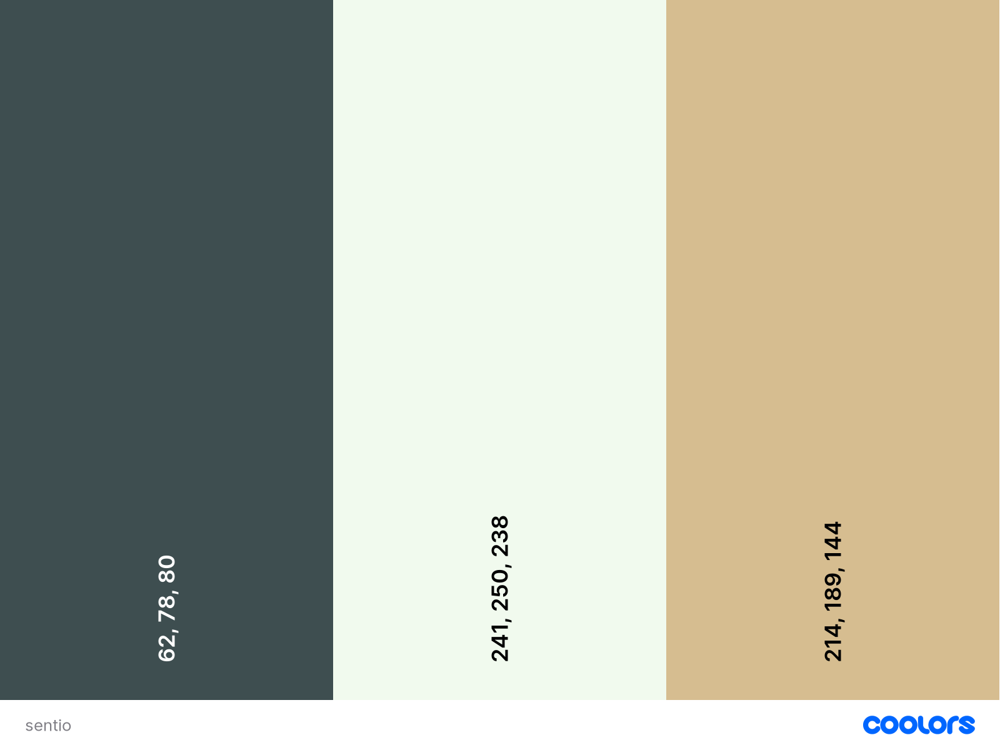
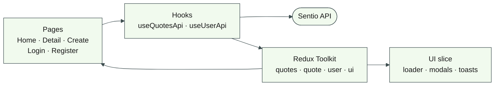

<div align="center">

# ❝ Sentio ❞

**A quiet place to keep the quotes that stayed with you, and share them.**


<sub>Front end · the API lives in <a href="https://github.com/Galan9999/Sentio-back"><b>Sentio-back</b></a></sub>

</div>

---

## The idea

Some sentences stay with you longer than the book they came from. Sentio is a small collection of them.
Each quote comes with its author, where they lived and when, a portrait, and a few lines of context, so it
reads like a page of a notebook and not like a social feed.

You can browse without an account. Sign up to add your own quotes, with a portrait of the author.

## The palette

Warm paper, sand and a deep slate green, set in **Belleza** and **Acme**.

<p align="center"></p>

| | Token | Hex | Used for |
|:-:|---|---|---|
|  | `mainColor` | `#D6BD90` | sand: buttons, accents |
|  | `terciaryColor` | `#3E4E50` | slate green: header, contrast surfaces |
|  | `secondaryColor` | `#F1FAEE` | cream: cards |
|  | `backgroundLightColor` | `#F1EFEF` | paper: page background |
|  | `mainTextColor` | `#181818` | ink: text |

All of it lives in [`src/styles/theme.ts`](src/styles/theme.ts) and reaches every component through the
styled-components `ThemeProvider`.

## What you can do

| | |
|---|---|
| 📖 **Browse** | The home page lists every quote as a card |
| 🔎 **Read** | `/detail/:id` shows the full quote: author, country, lifetime, tags, portrait and background |
| ✍️ **Add** | `/create` takes a quote with its portrait (protected route) |
| 🗑️ **Remove** | Delete a quote (signed in) |
| 🔐 **Sign up / log in** | JWT kept client-side and decoded with `jwt-decode`; protected and unprotected routes |

## How it is built



```
src/
├── components/   Button, QuoteCard, Quotes, Detail, CreateForm, LoginForm, RegisterForm,
│                 Header, Layout, Loader, Modals, ProtectedRoutes, UnprotectedRoutes
├── pages/        HomePage, DetailPage, CreatePage, LoginPage, RegisterPage
├── hooks/        useQuotesApi, useUserApi: every call to the API goes through them
├── store/        one slice per concern: quotes, quote, user, ui
├── router/       React Router 6, routes split into protected and unprotected
├── mocks/        MSW handlers, so tests never hit the real API
└── styles/       theme, global styles and the styled-components typing
```

## Quality

- **25 test files** with Jest and React Testing Library. Network calls are mocked with **MSW**, so hooks and
  pages are tested against realistic responses.
- **Husky + lint-staged**: Prettier and ESLint run before every commit.
- **GitHub Actions** on every push: tests, a code audit (ESLint, EditorConfig) and **SonarCloud** analysis.

## Run it

```bash
npm install
echo "REACT_APP_URL_API_USERS=<sentio-api-url>" > .env
npm start        # http://localhost:3000
npm test
```

You need the [Sentio API](https://github.com/Galan9999/Sentio-back) running, locally or deployed.

---

<div align="center">
<sub>Made by <a href="https://github.com/Galan9999">Carles Galán</a> · 2023</sub>
</div>
